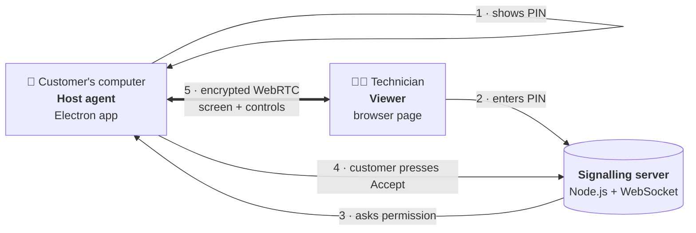

# 🪟 Ériu Remote Access
### *A window you open from the inside, and only ever from the inside*

> *Every good house has a door that locks from within. The visitor may knock, may wait on the step, may even know the address by heart. But the latch is yours, the hand on it is yours, and the door opens only when you choose.*
>
> *This is that door, for your computer.*

---

Somewhere in Ireland a printer refuses to print, an email refuses to send, and a perfectly reasonable person is about to throw a laptop into the Irish Sea. The old answer was to drive out there. The usual modern answer is to rent a commercial remote-desktop tool, at a licence fee that climbs every year like damp up a gable wall.

**Ériu Remote Access** is a third answer: a small, self-hosted remote **support** tool, built by [Eriu Technology Limited](https://eriu.tech) so a small IT business can help its own customers without renting someone else's keys.

It has one governing principle, and everything else bends around it:

<p align="center"><b>Nobody gets in unless the person at the computer says yes.</b></p>

> ⚠️ **Status: early prototype.** This works end to end, but it is *not yet ready for paying customers*. The open issues are listed plainly in [Before it goes near a client](#-before-it-goes-near-a-client). Please read that section before you build or run it.

---

## 📜 The Covenant

A remote support tool is a remarkable amount of trust, packed into a few hundred lines of code. These are the rules it is built on. They're why this is a support tool and not something nastier, and they are the line this project will never cross.

1. **Consent, every time.** When a technician enters the PIN, the customer sees a request with two big buttons, **Accept** and **Deny**. Nothing is shared until they press Accept.
2. **The customer starts it.** The customer opens the app themselves and reads the PIN aloud. There is no way to reach a computer that isn't showing a PIN.
3. **The customer can end it.** Closing the app ends the session instantly. A dedicated Stop button is on the roadmap.
4. **Out in the open.** No hidden windows, no silent installs, no running at startup behind anyone's back, no file harvesting, no keylogging. If you're looking for any of that, you're in the wrong repo.
5. **Encrypted in transit.** The screen and controls travel peer-to-peer over WebRTC, which is encrypted by design. The signalling connection uses `wss://` (TLS).

---

## 🧭 How it works

Three small pieces, each with one job:



| Piece | What it is | Where it lives |
|---|---|---|
| **Host agent** | The app the customer runs. Shows the PIN, asks for consent, shares the screen once accepted. | `eriu-remote-build/host-agent/` |
| **Signalling server** | The matchmaker. Hands out PINs and introduces the two sides, then steps aside. It never sees the screen. | `eriu-remote-build/signaling-server/` |
| **Viewer** | A plain web page the technician opens. No download, no install. | Hosted separately at `eriu.tech/remote/` |

1. The customer opens **Eriu Remote Access** and gets a 6-digit PIN.
2. They read it to the technician over the phone.
3. The technician types it into the viewer page.
4. The customer sees the request and chooses **Accept** or **Deny**.
5. On Accept, the two connect directly, peer to peer. The signalling server's work is done.

---

## 💻 Platforms

| Platform | Status |
|---|---|
| **macOS Catalina 10.15 and later**, Intel and Apple Silicon | ✅ Built by CI (`minimumSystemVersion: 10.15.0`) |
| **Windows 10 / 11**, x64 | ✅ Built by CI |
| Linux | 🗺️ Roadmap |
| Older Windows (7 / 8.1) | 🗺️ Roadmap, limited by what Electron still supports |

On macOS the customer must allow **Screen Recording** and **Accessibility** for the app the first time (System Preferences → Security & Privacy → Privacy). That's macOS protecting its users, and it's exactly the kind of gatekeeping this project approves of.

---

## 🛠️ Building

### Automatic builds (recommended)

Push a version tag and GitHub Actions builds both installers and attaches them to a Release:

```bash
git tag v1.0.0
git push origin v1.0.0
```

About ten minutes later the Release holds:
- `Eriu Remote Access Setup 1.0.0.exe`: Windows 10/11 installer
- `Eriu Remote Access-1.0.0.dmg`: macOS Catalina+ (Intel and Apple Silicon)

### Building locally, on a Mac

```bash
cd eriu-remote-build/host-agent
npm install
npm run build:mac     # DMG for Intel + Apple Silicon
```

Output lands in `eriu-remote-build/host-agent/dist/`.

### Running the signalling server

```bash
cd eriu-remote-build/signaling-server
npm install
npm start
```

In production it belongs behind a TLS reverse proxy (such as Caddy) so connections are `wss://`, kept alive with pm2 or systemd.

### Icons and code signing

- Add `assets/icon.icns` (macOS) and `assets/icon.ico` (Windows) before your first build, or you'll get Electron's default icon.
- Unsigned builds work but trigger a Gatekeeper or SmartScreen warning. To sign, add these as GitHub Actions secrets: `MAC_CERTS`, `MAC_CERTS_PASSWORD`, `APPLE_ID`, `APPLE_APP_SPECIFIC_PASSWORD`, `APPLE_TEAM_ID`. Without them CI still builds and skips signing.

---

## 🚧 Before it goes near a client

This section is here because honesty is cheaper than a breach. These are the known gaps, and none of them is optional before real customer use:

| Priority | Issue | Status |
|---|---|---|
| 🔴 High | **PIN brute-force protection.** The signalling server needs per-IP rate limiting and lockout on wrong PINs. | Open |
| 🔴 High | **Validate incoming input events.** Mouse and keyboard events from the viewer must be checked against an allowed list before they reach the operating system. | Open |
| 🟢 Done | **Encrypted signalling.** The host agent connects over `wss://`. | Fixed |
| 🟠 Planned | **Always-visible session banner** for the whole session, impossible for the viewer to hide. | Roadmap |
| 🟠 Planned | **A one-click Stop Sharing button** wired into the main process, plus a keyboard shortcut. | Roadmap |
| 🟠 Planned | **Per-session controls**: view-only by default, with control granted separately. | Roadmap |

The Accept/Deny prompt means a guessed PIN still can't get in without the customer's say-so. Even so, the high-priority items get fixed before this goes anywhere near a paying client.

---

## 🗂️ Repo layout

```
.github/workflows/
  build-release.yml        CI: builds Windows + macOS, publishes a Release
eriu-remote-build/
  host-agent/
    main.js                Electron main process (capture, input)
    preload.js             safe bridge between UI and main process
    renderer.js            host UI: PIN, Accept/Deny, WebRTC
    index.html             the host window
    package.json           electron-builder settings
    assets/                icons and macOS entitlements
  signaling-server/
    server.js              PIN pairing and WebSocket relay
    package.json
```

---

## 🧾 Licence

**All rights reserved, © 2026 Eriu Technology Limited.** The code is published so people can read it, learn from it and see how it works. It is not open for reuse, redistribution or commercial use without written permission.

---

<p align="center"><i>Built in Skerries, Co. Dublin, by an IT man who believes the best support visit is the one you invited.</i></p>
